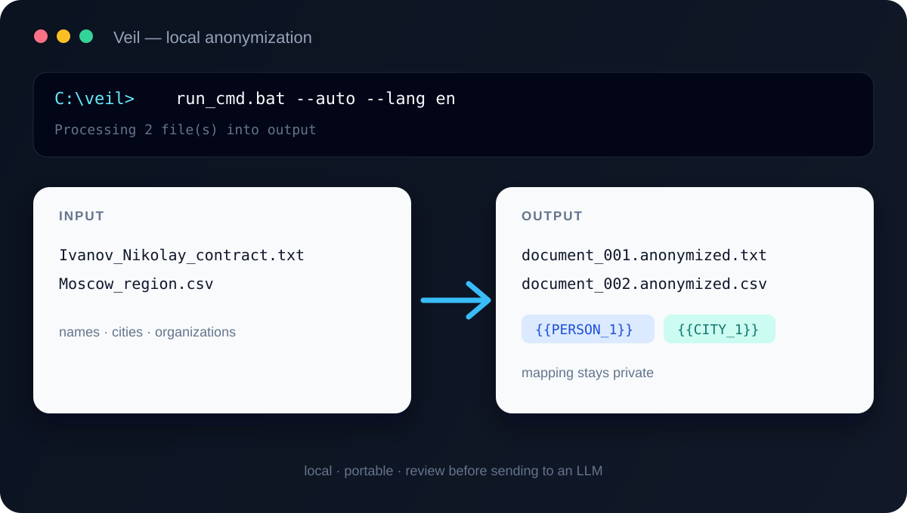

# Veil

<p align="center">
  
</p>

<p align="center"><strong>Local. Portable. Cautious by default.</strong></p>

Lightweight, local document anonymizer and privacy proxy for Windows, Linux, and macOS. Veil replaces names, organizations, contacts, credentials and other detected sensitive values before they are sent to an LLM.

There is no GUI, hosted service, Node.js, or local LLM. The core is Python; use the existing folder workflow or a local proxy for a terminal agent.

## Local agent privacy proxy

Keep source files local and filter text between the agent harness and model API:

```text
local files → local harness → Veil (mask) → cloud LLM
local tools ← local harness ← Veil (restore) ← response
```

Set `VEIL_UPSTREAM_API_KEY` securely in the proxy terminal, then:

```powershell
$env:VEIL_UPSTREAM_BASE_URL = "https://api.anthropic.com"
uv run python anonymize.py --proxy
# Portable Windows: run_cmd.bat --proxy
```

For **Codex signed in with ChatGPT**, no provider API key is required:

```powershell
uv run python anonymize.py --proxy --codex-chatgpt
```

Use the [ChatGPT subscription setup and separate Codex profile](docs/proxy.md#codex-with-your-chatgpt-subscription-no-api-key).
Codex keeps control of sign-in and refresh; Veil forwards credentials only to the
fixed ChatGPT service and requires a separate local token.

Veil listens on `127.0.0.1:8765` and creates a private client token in
`config/proxy_token`. Point the agent's base URL at Veil and give it that local
token. JSON and streaming text/tool calls are supported for Chat Completions,
Responses and Anthropic Messages. Unsupported content and inspection failures
are blocked, never silently forwarded. Mappings stay in request memory.

See the [setup guide, client examples and security boundaries](docs/proxy.md).
Automatic detection is best-effort; a proxy does not restrict the agent's own
network access or make confidential business content anonymous.



## Windows: fastest use with the portable release

1. Download `Veil-windows-x64.zip` from the [latest GitHub Release](https://github.com/KaigorodovTuskul/veil/releases/latest).
2. Extract it to a local folder.
3. Put source files into `input`.
4. Run `run_cmd.bat`.
5. Review files in `output` before sharing them.

The target Windows machine does not need Python or modified system environment variables.

When started without arguments, `run_cmd.bat` opens a menu with interactive/automatic modes for Russian, English, and Simplified Chinese. Command-line flags are also supported:

```bat
run_cmd.bat --auto --lang en
```

## Linux and macOS: run from source

Requirements: Python 3.12 or newer. No system-wide installation is required.

```bash
git clone https://github.com/KaigorodovTuskul/veil.git
cd veil
python3 -m venv .venv
./.venv/bin/python -m pip install -r requirements.txt
./.venv/bin/python anonymize.py --self-test
```

Put documents into `input`, then run either interactive or automatic mode:

```bash
./.venv/bin/python anonymize.py --lang en
./.venv/bin/python anonymize.py --auto --lang en
```

If `uv` is already installed, the shorter setup is:

```bash
uv sync --locked
uv run python anonymize.py --self-test
uv run python anonymize.py --auto --lang en
```

The same Python commands work on Windows when a portable EXE is not used. On Linux and macOS, the repository currently provides source-based execution rather than a prebuilt archive.

## Interface languages

The default language is Russian. One build supports all available languages:

| Code | Language | Example |
| --- | --- | --- |
| `ru` | Russian | `--lang ru` |
| `en` | English | `--lang en` |
| `zh` | Simplified Chinese | `--lang zh` |

Windows batch launcher:

```powershell
run_cmd.bat --lang en
run_cmd.bat --lang zh
```

Linux/macOS:

```bash
./.venv/bin/python anonymize.py --lang zh
```

You can also set `VEIL_LANG=ru`, `VEIL_LANG=en`, or `VEIL_LANG=zh`. An explicit `--lang` value takes priority.

For unattended replacement, use auto mode on any platform:

```powershell
# Windows
run_cmd.bat --auto --lang en

# Linux/macOS
./.venv/bin/python anonymize.py --auto --lang en
```

Auto mode replaces every detected value and does not ask per candidate. Review the result manually before external use.

## Input and output

Supported input formats:

- TXT, JSON, CSV
- DOCX
- legacy DOC
- RTF
- text-based PDF

PPTX and OCR are not included yet. Image-only PDF pages are reported as unsafe/incomplete and are not silently treated as clean text.

Output filenames preserve non-sensitive parts and replace detected sensitive fragments:

```text
input\policy-818 Example Organization LLC.rtf
output\policy-818.anonymized.rtf
output\policy-818.rtf.mapping.json
```

Detected sensitive fragments are removed from the output filename; the remaining safe parts are preserved. If no sensitive fragment is detected, the original filename stem is preserved. The original full filename and the removed fragment are stored in the private mapping file. Review mapping files before sharing them.

DOC, DOCX, and PDF are currently extracted to plain text. RTF keeps its RTF structure and formatting while replacing text; embedded RTF pictures and drawing objects are removed from the anonymized copy. The program prints warnings when a file contains unsupported or potentially unsafe content.

## Interactive review

For each detected value, choose:

```text
1 - replace this occurrence
2 - skip this occurrence
3 - replace all occurrences of this value
4 - stop without modifying the source
```

Repeated values receive the same placeholder, such as `{{PERSON_1}}` or `{{EMAIL_1}}`.

Rules are editable in [`patterns.json`](patterns.json). Matching is case-insensitive, so uppercase text is checked too. Common invisible spaces, Unicode dash variants, repeated spaces, and organization names with known suffixes are supported, including examples such as `Пупкинбанк` and `Пуп кинбанк`.

### Optional user dictionaries

Veil can use a small local dictionary without any additional dependency. On the first run it creates:

```text
config/user_keywords.csv
config/ignore_keywords.txt
```

Edit `config/user_keywords.csv` using UTF-8 and semicolon-separated columns:

```csv
type;keyword;aliases
ORGANIZATION;Example Company;Example Co|Example Company LLC
PERSON;Ivan Ivanov;Ivanov I.I.
CITY;Yakutsk;Якутске|г. Якутск
REGION;Sakha Republic;Republic of Sakha
```

Supported types are `PERSON`, `ORG`/`ORGANIZATION`, `CITY`, `REGION`, `COUNTRY`, `ADDRESS`, and `SENSITIVE`. Matching ignores case and accepts flexible whitespace between words. Put one normalized word or phrase per line into `config/ignore_keywords.txt` to suppress an exact candidate. User dictionary entries are also applied to filenames.

The actual dictionary files are ignored by Git because they may contain confidential names. Only safe `.example` templates are included in the repository and portable archive. Do not commit real keywords or mapping files.

Detection is heuristic and best-effort. Arbitrary misspellings are not guessed without context because fuzzy matching can hide normal words by mistake. Always inspect the anonymized document manually before sending it outside the machine.

When a file cannot be safely processed, Veil continues with the remaining files and writes a neutral `document_NNN.<ext>.error.txt` report in `output`. Image-only PDFs receive this status because OCR is not enabled.

## Restore an anonymized text file

Every processed file gets a mapping file containing the original sensitive values. Keep it private and never send it to an LLM.

```powershell
anonymizer.exe --restore output\document_001.anonymized.txt output\document_001.txt.mapping.json
```

The restored file is written next to the anonymized file with a `.restored` suffix. Restoration is intended for text-compatible output; it does not recreate original DOC/DOCX/PDF formatting.

## Build the Windows portable ZIP

Requirements on the build machine: Windows, Python 3.12+, and either `uv` or standard `venv`/`pip`.

### Recommended: uv

```powershell
uv sync --locked
uv run python anonymize.py --self-test
.\build_portable.ps1
Compress-Archive -Path dist\anonymizer\* -DestinationPath dist\Veil-windows-x64.zip -Force
```

The resulting archive is `dist\Veil-windows-x64.zip`. It contains a self-contained one-folder application with `anonymizer.exe`, `patterns.json`, `run_cmd.bat`, and safe dictionary templates under `config`.

Linux and macOS portable builds are not published yet. They can run directly from the virtual environment described above.

### Fallback: standard Python

```powershell
python -m venv .venv
.\.venv\Scripts\python.exe -m pip install -r requirements.txt
.\.venv\Scripts\python.exe anonymize.py --self-test
powershell -NoProfile -ExecutionPolicy Bypass -File .\build_portable.ps1
Compress-Archive -Path dist\anonymizer\* -DestinationPath dist\Veil-windows-x64.zip -Force
```

## Development checks on any platform

```powershell
uv sync --locked
uv run python anonymize.py --self-test
uv run python -m unittest discover -s tests -v
uv run python tests/benchmark.py
uv run python -m py_compile anonymize.py extractors.py i18n.py veil_proxy.py veil_protocol.py
git diff --check
```

If `uv` is unavailable, use the Python executable from `.venv` instead. CI runs the self-test and privacy integration tests on Windows, Linux and macOS, and builds the Windows portable package.

## Repository layout

```text
anonymize.py          cross-platform CLI, auto mode, and restore mode
veil_proxy.py         local HTTP privacy proxy and client authentication
veil_protocol.py      request policy, shared mappings and JSON/SSE restoration
extractors.py         TXT/JSON/CSV/DOC/DOCX/RTF/PDF extraction
i18n.py               Russian, English, and Simplified Chinese UI
patterns.json         configurable detection rules
config/               safe user dictionary templates; local files are ignored
run_cmd.bat           folder-mode launcher
build_portable.ps1    PyInstaller one-folder build
input/                local source files; ignored by Git
output/               local results and mappings; ignored by Git
```

## Security notes

- Mapping files contain the original values and are equivalent to sensitive data.
- Do not commit real documents, output files, mapping files, or personal data.
- A successful run is not proof that every PII value was found.
- Review every anonymized file and the console warnings before external use.

See [`SECURITY.md`](SECURITY.md), [`CONTRIBUTING.md`](CONTRIBUTING.md), and [`CHANGELOG.md`](CHANGELOG.md).

## License

MIT — see [LICENSE](LICENSE).
